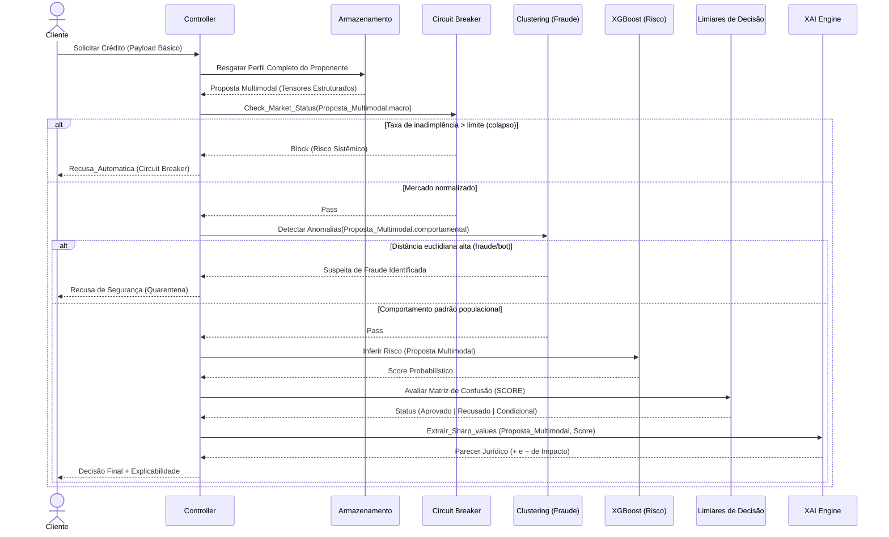

# Especificação: Pipeline de Decisão de Crédito (BDD)

> Documento derivado do diagrama de sequência do projeto. Serve como contexto para desenvolvimento assistido por IA usando BDD (Behavior-Driven Development).

## 1. Visão geral

Um **Cliente** solicita crédito. O **Controller** orquestra uma sequência de verificações e modelos, e devolve uma **decisão final com explicabilidade**. O fluxo tem dois desvios (recusas antecipadas) antes de chegar à inferência de risco:

1. **Circuit Breaker** — bloqueia se o mercado está em colapso.
2. **Clustering** — bloqueia se o comportamento sugere fraude/bot.
3. **XGBoost → Limiares → XAI** — só executa se os dois anteriores passarem.

## 2. Componentes

| Componente | Papel | Entrada | Saída |
|---|---|---|---|
| **Cliente** | Ator que solicita crédito | — | Payload básico |
| **Controller** | Orquestrador do fluxo | Payload básico | Decisão final + explicabilidade |
| **Armazenamento** | Repositório de perfis | Identificação do proponente | Proposta Multimodal (tensores estruturados) |
| **Circuit Breaker** | Proteção contra risco sistêmico | `Proposta_Multimodal.macro` | `Block` ou `Pass` |
| **Clustering (Fraude)** | Detecção de anomalias comportamentais | `Proposta_Multimodal.comportamental` | `Suspeita de Fraude` ou `Pass` |
| **XGBoost (Risco)** | Modelo de risco de crédito | `Proposta_Multimodal` | Score probabilístico (ex.: 0,15) |
| **Limiares de Decisão** | Aplica regras sobre o score (matriz de confusão) | `SCORE` | Status: `Aprovado` \| `Recusado` \| `Condicional` |
| **XAI Engine** | Explicabilidade via valores SHAP | `Proposta_Multimodal`, `Score` | Parecer jurídico (fatores com impacto positivo e negativo) |

## 3. Fluxo principal (sequência)

1. `Cliente → Controller`: **Solicitar Crédito** (payload básico)
2. `Controller → Armazenamento`: **Resgatar Perfil Completo do Proponente**
3. `Armazenamento → Controller`: **Proposta Multimodal** (tensores estruturados)
4. `Controller → Circuit Breaker`: **Check_Market_Status**(`Proposta_Multimodal.macro`)
5. **ALT — Taxa de inadimplência > limite (colapso)**
   - `Circuit Breaker → Controller`: **Block** (risco sistêmico)
   - `Controller → Cliente`: **Recusa_Automatica** (Circuit Breaker)
   - *Fim do fluxo*
6. **ELSE — Mercado normalizado**
   - `Circuit Breaker → Controller`: **Pass**
7. `Controller → Clustering`: **Detectar Anomalias**(`Proposta_Multimodal.comportamental`)
8. **ALT — Distância euclidiana alta (fraude/bot)**
   - `Clustering → Controller`: **Suspeita de Fraude Identificada**
   - `Controller → Cliente`: **Recusa de Segurança** (quarentena)
   - *Fim do fluxo*
9. **ELSE — Comportamento padrão populacional**
   - `Clustering → Controller`: **Pass**
10. `Controller → XGBoost`: **Inferir Risco**(Proposta Multimodal)
11. `XGBoost → Controller`: **Score Probabilístico** (ex.: 0,15)
12. `Controller → Limiares de Decisão`: **Avaliar Matriz de Confusão**(SCORE)
13. `Limiares → Controller`: **Status** (Aprovado | Recusado | Condicional)
14. `Controller → XAI Engine`: **Extrair_Sharp_values**(Proposta_Multimodal, Score)
15. `XAI Engine → Controller`: **Parecer Jurídico** (fatores + e − de impacto)
16. `Controller → Cliente`: **Decisão Final + Explicabilidade**

### Diagrama (Mermaid)



## 4. Regras de negócio

- **RN01** — O perfil do proponente deve ser recuperado do Armazenamento antes de qualquer análise.
- **RN02** — Se a taxa de inadimplência de mercado exceder o limite configurado, a solicitação é recusada automaticamente, sem executar fraude ou risco.
- **RN03** — Se o comportamento do proponente estiver a uma distância euclidiana alta do padrão populacional (fraude/bot), a solicitação é recusada por segurança e enviada para quarentena.
- **RN04** — O modelo de risco só é executado quando Circuit Breaker e Clustering retornam `Pass`.
- **RN05** — O score probabilístico é convertido em um status (`Aprovado`, `Recusado` ou `Condicional`) pelos limiares de decisão.
- **RN06** — Toda decisão que chega até o fim do fluxo deve vir acompanhada de explicação (valores SHAP) e parecer com fatores de impacto positivo e negativo.
- **RN07** — A ordem de execução é fixa: Circuit Breaker → Clustering → XGBoost → Limiares → XAI.

## 5. Cenários BDD (Gherkin)

```gherkin
# language: pt
Funcionalidade: Decisão de crédito com proteção sistêmica, detecção de fraude e explicabilidade

  Contexto:
    Dado que existe um proponente com perfil completo no Armazenamento
    E que o Controller está disponível

  Cenário: Recusa automática por colapso de mercado
    Dado que a taxa de inadimplência do mercado é maior que o limite configurado
    Quando o cliente solicita crédito
    Então o Circuit Breaker deve retornar "Block" por risco sistêmico
    E o Controller deve responder ao cliente com "Recusa_Automatica (Circuit Breaker)"
    E o Clustering não deve ser executado
    E o XGBoost não deve ser executado

  Cenário: Recusa de segurança por suspeita de fraude ou bot
    Dado que o mercado está normalizado
    E que o comportamento do proponente tem distância euclidiana alta em relação ao padrão populacional
    Quando o cliente solicita crédito
    Então o Circuit Breaker deve retornar "Pass"
    E o Clustering deve retornar "Suspeita de Fraude Identificada"
    E o Controller deve responder ao cliente com "Recusa de Segurança (Quarentena)"
    E o XGBoost não deve ser executado

  Cenário: Crédito aprovado com explicabilidade
    Dado que o mercado está normalizado
    E que o comportamento do proponente segue o padrão populacional
    E que o XGBoost retorna um score que os limiares classificam como "Aprovado"
    Quando o cliente solicita crédito
    Então o Controller deve invocar o XAI Engine com a proposta multimodal e o score
    E a decisão final deve ser "Aprovado"
    E a resposta deve conter o parecer com fatores de impacto positivo e negativo

  Cenário: Crédito recusado pelo modelo de risco com explicabilidade
    Dado que o mercado está normalizado
    E que o comportamento do proponente segue o padrão populacional
    E que o XGBoost retorna um score que os limiares classificam como "Recusado"
    Quando o cliente solicita crédito
    Então a decisão final deve ser "Recusado"
    E a resposta deve conter o parecer com os fatores que mais pesaram na recusa

  Cenário: Crédito condicional
    Dado que o mercado está normalizado
    E que o comportamento do proponente segue o padrão populacional
    E que o XGBoost retorna um score que os limiares classificam como "Condicional"
    Quando o cliente solicita crédito
    Então a decisão final deve ser "Condicional"
    E a resposta deve conter o parecer explicativo

  Esquema do Cenário: Classificação do score pelos limiares de decisão
    Dado que o XGBoost retornou o score <score>
    Quando os Limiares de Decisão avaliam o score
    Então o status deve ser "<status>"

    Exemplos: (valores ilustrativos, definir os limiares reais)
      | score | status      |
      | 0,05  | Aprovado    |
      | 0,15  | Aprovado    |
      | 0,40  | Condicional |
      | 0,80  | Recusado    |

  Cenário: Ordem de execução do pipeline
    Dado que o mercado está normalizado
    E que não há suspeita de fraude
    Quando o cliente solicita crédito
    Então os componentes devem ser invocados na ordem:
      | ordem | componente         |
      | 1     | Armazenamento      |
      | 2     | Circuit Breaker    |
      | 3     | Clustering         |
      | 4     | XGBoost            |
      | 5     | Limiares de Decisão|
      | 6     | XAI Engine         |
```

## 6. Contratos sugeridos (para a IA implementar)

```text
Proposta_Multimodal
├── macro           → indicadores de mercado (ex.: taxa de inadimplência)
├── comportamental  → features de comportamento (usadas no clustering)
└── (demais tensores estruturados do perfil)

Resposta ao cliente
├── decisao: "Aprovado" | "Recusado" | "Condicional" | "Recusa_Automatica" | "Recusa_Seguranca"
├── motivo: string
└── explicabilidade: { fatores_positivos: [...], fatores_negativos: [...] }   # apenas no fluxo completo
```

## 7. Pontos em aberto (definir antes de implementar)

- Valor do **limite de inadimplência** do Circuit Breaker.
- Valor do **limiar de distância euclidiana** e o algoritmo de clustering (ex.: K-Means, DBSCAN).
- **Limiares** do score que separam Aprovado / Condicional / Recusado. O diagrama mostra o exemplo `0,15` e não define as faixas.
- O que acontece com a **quarentena** (apenas recusa ou há fila de revisão?).
- Formato do **Parecer Jurídico** (texto livre ou estruturado) e como os valores SHAP são traduzidos para ele.
- Estratégia para **falhas** (ex.: timeout de um componente), que o diagrama não cobre.

## 8. Sugestão de uso com a IA (BDD)

1. Peça à IA para implementar **um cenário por vez**, começando pelos de recusa antecipada (mais simples).
2. Gere primeiro os **testes (steps)** a partir do Gherkin, depois o código que os faz passar.
3. Use **mocks** para Armazenamento, Circuit Breaker, Clustering, XGBoost, Limiares e XAI; troque por implementações reais gradualmente.
4. Resolva os **pontos em aberto** da seção 7 como parâmetros configuráveis.
